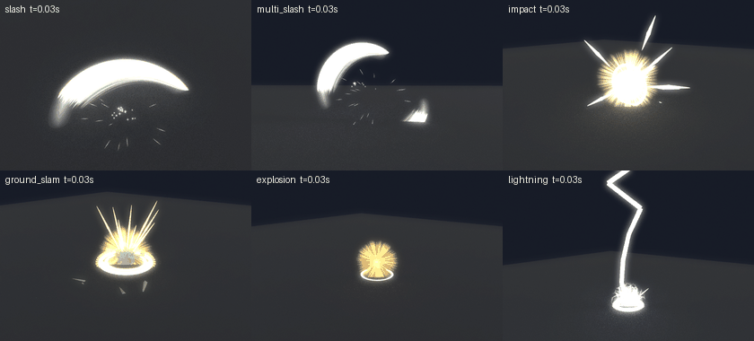
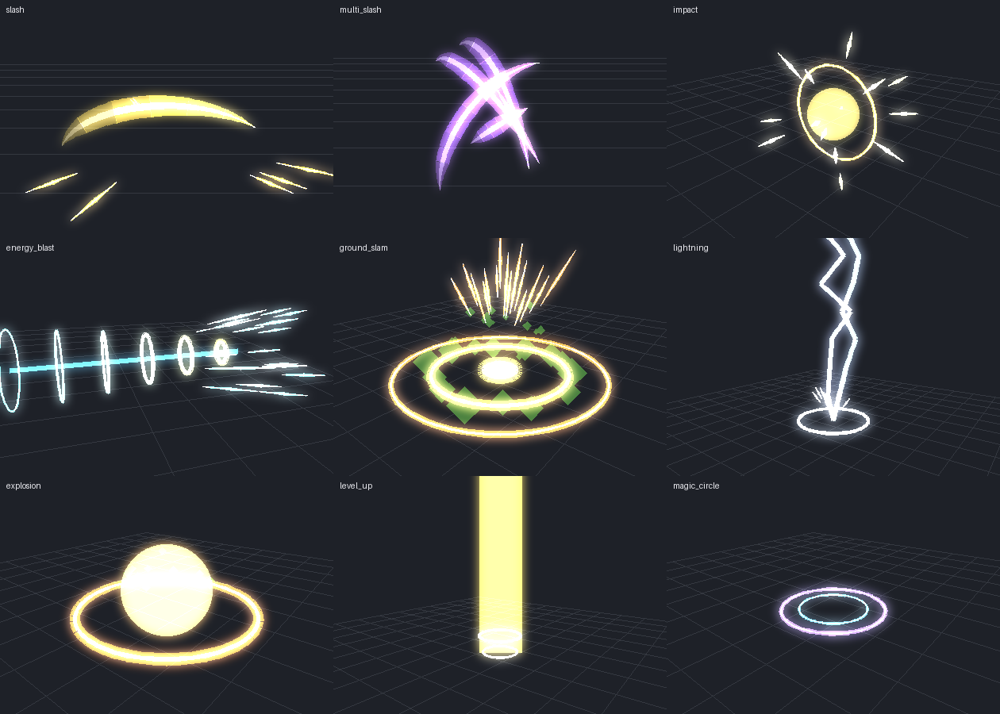
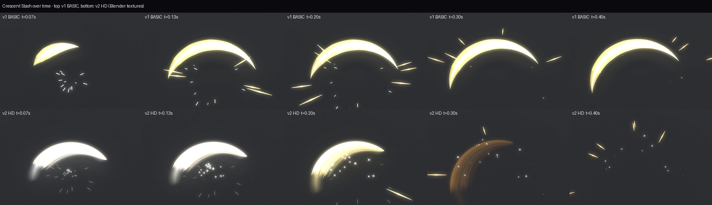
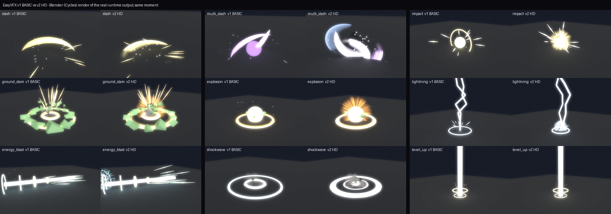
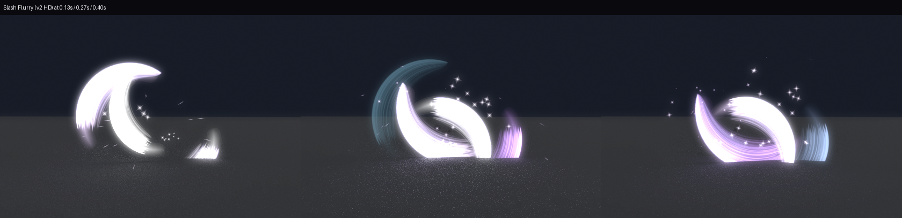
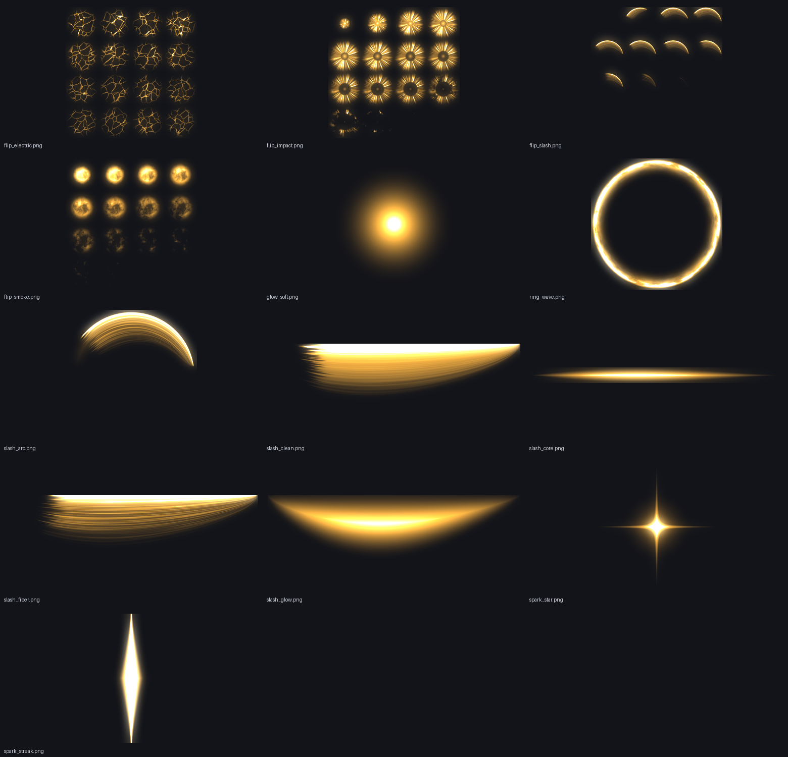
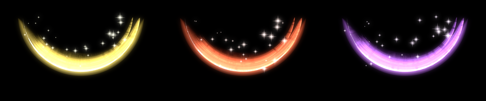

# EasyVFX — Beautiful Roblox Studio effects, zero code

EasyVFX is a Roblox Studio plugin that lets people **who don't code** make visual effects (VFX) with clicks only:
pick an object → click an effect → change colors and drag sliders → choose *when* it plays. Done.


*Six HD effects running: the EasyVFX runtime plays them in a simulated environment (Lune) and every frame is re-rendered in Blender Cycles, at half speed. This is an approximation, not a Roblox screen recording. The rocks are green because the simulated ground is grass.*


*Shapes rebuilt from runtime data (rings, slashes, needles, lightning, crater rocks) by `tools/render_snapshot.py`. An approximate preview, not a Roblox screenshot.*

---

## 1. Install (1 minute)

Download `EasyVFX.rbxmx` from the [latest release](../../releases/latest) (or use `build/EasyVFX.rbxmx` from this repo).

**Option A — Plugins folder (recommended)**
1. Open Roblox Studio → **Plugins** tab → **Plugins Folder**.
2. Copy `EasyVFX.rbxmx` into that folder.
3. Restart Studio. An **EasyVFX** button appears in the Plugins tab.

**Option B — Save as Local Plugin**
1. Drag `EasyVFX.rbxmx` into the Studio window.
2. Right-click the `EasyVFX` Script in the Explorer → **Save as Local Plugin…**, then delete the copy from your game.

The first time you open it, a **3-step guide** appears. You can skip it and replay it later from **Help**.

---

## 2. How to use

| Step | What to do |
|---|---|
| 1. Pick a spot | Click a Part, a Model (character) or an Attachment. With nothing selected, the effect is placed **where the camera is looking**. Selecting a Baseplate (a very large part) counts as "the ground". |
| 2. Add an effect | **Library** tab → search by name (e.g. "slash", "lightning") or filter by category → click a card. The effect is added instantly; **Ctrl+Z** undoes it. |
| 3. Customize | The **Customize** tab opens: change **Main / Second color** (click a swatch or type `#FFAA00`), drag **Size, Amount, Speed, Lifetime, Glow**. |
| 4. Choose a trigger | **Always on**, **Repeat**, **On touch**, **On click**, **On key E** (ProximityPrompt) or **From a script**. |
| 5. Try it | **Preview** plays it right in Studio. Press **Play (F5)** to run it for real. |

Each effect is **one invisible Part** named `VFX_…` — move, rotate, duplicate or delete it like any Part. Select it again any time to keep editing.

The panel is in English by default; the **VI** button switches it to Vietnamese.

### 30 built-in effects

- **Combat:** Crescent Slash, Slash Flurry, Hit Impact, Ground Slam (crater + flying rocks), Energy Blast, Explosion, Lightning Strike, Shockwave, Weapon Trail.
- **Magic:** Magic Circle, Heal, Level Up, Power Aura, Portal, Energy Shield, Energy Orb, Sparkles.
- **Elements:** Fire, Smoke, Frost, Fountain.
- **World:** Rain, Snow, Fireflies, Ground Fog, Confetti, Bubbles.
- **Light:** Laser Beam, Soft Glow, Glowing Outline (Highlight).

Effects you use often can be saved with **Advanced → Save to Favorites** and re-added with one click from the top of the Library tab.

---

## 3. Why the effects look sharp

Roblox's built-in textures are soft, so EasyVFX builds its crisp parts from **geometry** instead of images:

| Piece | How it's made | Used in |
|---|---|---|
| **Ring** | 4 curved Bezier Beams (CurveSize = r·4/3·tan(π/8) ≈ 0.5523r), white core + colored rim, expanding and fading | shockwaves, ring tunnels, magic circles |
| **Slash** | Crescent ribbon of curved Beams: sharp at both ends, thick near the head, fading tail, sweeping an angle | slash, slash flurry |
| **Lines** | Needle streaks pointed at both ends, shooting out (sphere / ring / up / forward) | impact, ground slam, aura |
| **Bolt** | Zig-zag lightning that reshapes every ~0.05 s and flickers | lightning |
| **Orb** | **Neon / ForceField** part that grows and fades (balls, pillars, beam cores) | explosion, level up, energy blast |
| **Crater / Debris** | Rocks bursting up in a ring then sinking; rocks thrown on a ballistic path, colored and textured like the ground below | ground slam, explosion |

On top of that, sparks use a square texture stretched along their velocity (`VelocityParallel` + `Squash`) with `LightEmission = 1` for additive glow.
**Tip:** click **Add Bloom to Lighting** (in Advanced or Help) to make Neon and glowing streaks pop like anime.

## 3b. HD quality with Blender (v2)

v1 is sharp but **rough**. Compared with reference art (yellow/red/purple slash trio, energy blast, ground slam), v1 falls short in five ways:

| Reference art has | v1 (geometry only) | v2 HD (Blender textures) |
|---|---|---|
| A slash body made of **many thin strands** with varied brightness | One flat-colored ribbon | Strand detail from stretched Noise in a Blender shader |
| **Frayed, dissolving tail**, ragged inner edge | Smooth edges, disappears abruptly | Every strand ends at a different length; 16-frame flipbook dissolves with noise |
| **Hot outer edge + tight glow** | No glow, even core | Hot rim + soft glow baked into the texture, additive LightEmission |
| **White flash → color → gone**, very fast | Fixed color, lingers | Color over life: white → main → second color in ~0.35 s |
| **Sparkles scattered along the arc** | Sparks from the center | Sharp 4-point stars along the arc + sparks |





*These images are Blender Cycles renders of the **real data the EasyVFX runtime produces** (`tests/snapshot.luau` → `tools/blender_preview.py`). The script re-simulates particles from their Roblox properties (speed, drag, size/transparency over life, flipbooks, quad orientation). They are approximations, **not Roblox screenshots**.*

### Turn on HD (once, works in every place)

1. Studio → **File → Import 3D** → pick `pack/EasyVFX_Pack.fbx` (also attached to the release) → **Import**. Studio uploads the textures embedded in the file.
2. Plugin → **Library** tab → **HD quality** card → **Scan pack**. The plugin finds the `EVFX_Tex_*` parts, reads their image IDs and updates every effect.
3. You can delete the imported model. The image IDs are saved in the plugin settings, so other places can use them right away.

If Scan pack finds no IDs (Import 3D sometimes doesn't assign textures), use **Asset Manager → Bulk Import** on the `pack/textures/` folder, then click **Paste IDs** and enter one pair per line, e.g. `slash_arc = 1234567890` (name = file name without `.png`). `slash_arc` is required for HD to turn on.

With HD on:
- 8 presets get dedicated HD layers: Crescent Slash, Slash Flurry, Hit Impact, Ground Slam, Explosion, Lightning Strike, Energy Blast, Shockwave.
- Every other preset swaps Roblox's soft built-in textures (star, glow, square streak) for the sharp ones.
- Turning HD off returns effects to the basic version; nothing is lost.

HD slashes are flat particles (`VelocityPerpendicular`). If the arc points the wrong way in Studio, use the **Rotation** slider in the Customize tab.

### What's in the HD pack



| Texture | Used for |
|---|---|
| `slash_arc` (1024², fibrous crescent) | HD slash body |
| `flip_slash` (4×4 flipbook) | Slash appearing then dissolving |
| `flip_impact`, `flip_smoke`, `flip_electric` (4×4) | Spiky impact burst, dust/smoke, electric crackle |
| `ring_wave` | Noisy ground shockwave ring |
| `spark_star`, `spark_streak`, `glow_soft` | Twinkles, sparks, soft glow |
| `slash_fiber`, `slash_clean`, `slash_glow`, `slash_core` | Straight strip textures for Beams/Trails/meshes |
| Meshes `EVFX_Mesh_SlashWide`, `SlashThin`, `SpinRing` | UV-mapped 3D slashes, for the mesh feature below |


*Blender look-dev render: glow, strands, core and stars in three colors like the reference art.*

### Regenerate / tweak the pack with your own Blender

The script is plain Python for Blender (4.2+ or 5.x), no add-ons needed:

```bash
blender -b -P blender/make_vfx_pack.py -- --out ./pack            # render the whole pack + FBX
blender -b -P blender/make_vfx_pack.py -- --out ./pack --only slash_arc,flip_slash --samples 64
```

Or open Blender → **Scripting** tab → open the file → **Run Script**. The look lives in `slash_shape()`: thickness, strand length (`fib_n`), tail fraying (`tail`) and the inner edge (`reach`). Change the numbers and re-run for your own style.

### Using meshes made in Blender

Put a **MeshPart** (e.g. a slash exported from Blender) inside a `VFX_…` Part and add the attribute `VFX_Mesh = true`. When the effect plays, the runtime copies the mesh, then scales, spins and fades it. Optional attributes: `Scale0` (default 0.6), `Scale1` (1.4), `SpinDeg` (Vector3, default 0,90,0), `AnimDuration` (0.5 s), `EmitDelay`, `BaseTransparency`. Set the source mesh's `Transparency = 1` so it stays hidden until played.

---

## 4. Performance (following Roblox DevForum advice)

- **Effects run on each player's device (client).** When triggered on the server (touch, click, key E), the server sends **one small RemoteEvent**. Each client builds and animates the effect itself, so the server creates no instances and the network carries no moving parts.
- **Repeating effects run entirely on the client**, so they cost no bandwidth.
- **Automatic quality scaling** when a player picks low graphics: particle, needle and rock counts go down (`EasyVFX.Quality`).
- **Temporary pieces** live in the Camera with `Archivable = false`, `CanCollide/CanTouch/CanQuery = false` and no shadows. They are never saved with the place and never block gameplay raycasts.
- **One animation loop** for all effects — no per-piece tweens or threads. Flying rocks use hand-computed trajectories, not physics.
- Emitter Rate is capped at 400; at most 64 rocks/needles per layer.
- Follows the **community attribute convention** `EmitCount`, `EmitDelay`, `EmitDuration`, so EasyVFX effects work with other Emit plugins and vice versa.

---

## 5. For scripters (optional)

The plugin installs three things into your game **once**, when you add your first effect:

| Object | Location | Role |
|---|---|---|
| `EasyVFX` (ModuleScript) | ReplicatedStorage | Runtime that plays effects + API |
| `EasyVFXServer` (Script) | ServerScriptService | Wires up touch / click / key E triggers |
| `EasyVFXClient` (LocalScript) | StarterPlayerScripts | Plays effects on each player's device, runs loops |

```lua
local EasyVFX = require(game.ReplicatedStorage.EasyVFX)

EasyVFX.Play(workspace.Sword.VFX_CrescentSlash)              -- play in place (server: plays for everyone)
EasyVFX.Play("VFX_Explosion", CFrame.new(0, 5, 0))           -- play a copy somewhere else
EasyVFX.SetEnabled(workspace.Torch.VFX_Fire, false)          -- turn always-on layers off
```

Choosing the **From a script** trigger shows a ready-to-paste line with the correct path. All effect settings are stored in the Part's `VFX_*` attributes and can be edited in the Properties window.

---

## 6. Interface

Designed with the **UI UX Pro Max** skill (design system *Minimalism & Swiss Style*, *Developer Tool / IDE* palette: slate surfaces, green action buttons, dense dashboard spacing):
- **English / Vietnamese** (VI/EN button), follows Studio's light/dark theme.
- Every input has a visible label and hint; exact numbers can be typed next to each slider.
- **Advanced** is collapsed so beginners aren't overwhelmed; the 3-step guide can be skipped.
- A message after every action, two-click confirmation before deleting, and Ctrl+Z for everything.
- No emoji icons; 120–180 ms hover transitions.

---

## 7. Code layout & testing (for developers)

```
src/Plugin/
  init.server.luau        plugin: toolbar, dock panel, inserting effects, undo, runtime install
  Shared/Presets.luau     30 presets (plain data)
  Shared/Builder.luau     preset + settings -> instances (updated in place, no flicker)
  Shared/Strings.luau     English / Vietnamese text
  Runtime/EasyVFX.luau    runtime: emit, Ring/Slash/Lines/Bolt/Orb/Debris/Crater, triggers
  Runtime/EasyVFXServer.server.luau, EasyVFXClient.client.luau   (disabled in the plugin, enabled when installed)
  UI/Theme.luau, Components.luau, App.luau
blender/    make_vfx_pack.py (builds the HD pack: textures, flipbooks, meshes, FBX)
pack/       pre-rendered HD pack: EasyVFX_Pack.fbx + textures/*.png
tests/      run.luau (builder+runtime), ui.luau (clicks through the whole GUI), snapshot.luau (exports runtime data)
tools/      blender_preview.py, render_snapshot.py, view_textures.py, check.sh
```

Tools: [Rojo](https://github.com/rojo-rbx/rojo) 7.4, [Lune](https://github.com/lune-org/lune) 0.8, [luau-lsp](https://github.com/JohnnyMorganz/luau-lsp) (with `globalTypes.d.luau`).

```bash
rojo build default.project.json -o build/EasyVFX.rbxmx   # build the plugin
lune run tests/run.luau        # 1229 checks: create/update/play/clean up every preset, Basic and HD
lune run tests/ui.luau         # 856 checks: every button, tab, slider, trigger and the HD card
tools/check.sh                 # all of the above + strict type check

# Blender previews from runtime data (pip install bpy, or run with blender -b -P)
lune run tests/snapshot.luau snap.json hd                       # or: basic / add "slash 2,4,6" for a timeline
python tools/blender_preview.py snap.json out/ pack/textures <Roblox built-in textures converted to png>
```

Tests run under Lune with real Roblox Instances from the reflection database (wrong property names or types fail). Engine functions (`Emit`, `Raycast`, GUI events) are mocked. Lighting and the real renderer still need to be checked in Studio.

---

## References

- Roblox Creator Docs: [Particle emitters](https://github.com/Roblox/creator-docs/blob/main/content/en-us/effects/particle-emitters.md), [Beams (Bezier curve)](https://github.com/Roblox/creator-docs/blob/main/content/en-us/effects/beams.md), [Trails](https://github.com/Roblox/creator-docs/blob/main/content/en-us/effects/trails.md), [Explosion VFX tutorial](https://create.roblox.com/docs/tutorials/use-case-tutorials/vfx/use-particles-for-explosions)
- DevForum, client-side VFX: [Client-Sided VFX](https://devforum.roblox.com/t/client-sided-vfx/2792835), [VFX fire from client recommended?](https://devforum.roblox.com/t/vfx-fire-from-client-recommended-why-or-server-ok/3660009), [Remote events for effects](https://devforum.roblox.com/t/is-using-remote-events-to-play-effects-on-the-client-resource-efficient/3754781), [Optimize VFX at low graphics](https://devforum.roblox.com/t/how-to-optimize-vfx-and-retain-quality-at-low-graphics/2804870)
- DevForum, circles from Beams: [Creating a circular beam](https://devforum.roblox.com/t/creating-a-circular-beam/2436266), [Circle shape with Beam](https://devforum.roblox.com/t/circle-shape-with-beam/228156), [Beam ring tween](https://devforum.roblox.com/t/beam-ring-improvement/3980748)
- DevForum, EmitCount/EmitDelay convention: [Jad's Emit Plugin](https://devforum.roblox.com/t/dear-vfx-makers-i-present-to-you-jads-emit-plugin/1986838), [VFX Editor](https://devforum.roblox.com/t/vfx-editor-all-your-vfx-needs-in-one/3103467), [How can I emit particles properly](https://devforum.roblox.com/t/how-can-i-emit-particles-properly/3548786)
- DevForum, anime rocks / craters: [Rock Module](https://devforum.roblox.com/t/rock-module-v10-craters-explosions-and-more-effects/3041562), [Crater system](https://devforum.roblox.com/t/crater-system-by-frodev/2628508), [Anime VFX beginner guide](https://devforum.roblox.com/t/full-beginners-guide-on-scripting-animefighting-vfxvisual-effects-part-1/1610853)
- DevForum, mesh / Blender slashes: [Animated slash effects with Blender](https://devforum.roblox.com/t/how-to-make-animated-slash-effects-with-only-blender/1794034), [Animated Slashes 2.0](https://devforum.roblox.com/t/how-to-make-animated-slashes-20/1880010)
- Slash gradient + noise + dissolve technique: [Godot Slash Shader](https://godotshaders.com/shader/slash-shader/), [Unity VFX Stylized Ground Slash (Udemy)](https://www.udemy.com/course/unity-vfx-stylized-ground-slash/), [Realtime VFX – Sword Slash help](https://realtimevfx.com/t/sword-slash-help/9407)
- Flipbooks / textures in Roblox: [Create basic visual effects](https://create.roblox.com/docs/tutorials/curriculums/core/building/create-basic-visual-effects), [How to create VFX? (DevForum)](https://devforum.roblox.com/t/how-to-create-vfx/4029502), [LightEmission with black](https://devforum.roblox.com/t/when-coloring-particles-with-lightemission-1-to-black-they-become-transparent/2614320)
- Blender: [bpy on PyPI](https://pypi.org/project/bpy/)
- Design system: [UI UX Pro Max skill](https://github.com/nextlevelbuilder/ui-ux-pro-max-skill)
