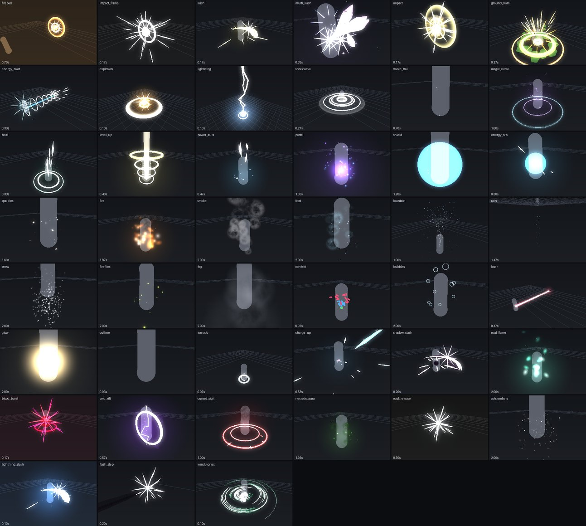

# The agentic loop: changing an effect without opening Studio

`tools/evfx` lets an agent (or you) change a preset, see it, measure it and prove it got better, all in a terminal.
Studio is opened once, at the end, to look at the result for real.

```bash
pip install -r tools/evfx/requirements.txt   # numpy and Pillow; Lune comes from rokit
python3 tools/evfx audit                      # every preset: peaks, gates, scores (about 2 minutes)
python3 tools/evfx sheet                      # every preset at its busiest moment, one image
```


*`evfx sheet`: every preset rendered from its Lune timeline. An approximation, not a Roblox screenshot.*

## How it works

1. **Timeline.** `tests/timeline.luau` plays a preset with the real runtime under Lune and records every frame of one
   play (30 per second): beams, visible pieces, lights, screen effects, the camera's FOV, every emitter that streams
   and every burst with the frame it fired. It writes `.cache/evfx/timeline/<mode>/<preset>.json`.
2. **Render.** Particles aren't recorded; they are re-simulated from their emitter settings the way Roblox documents
   them (speed, spread, acceleration, `Drag` halving the speed every `1 / Drag` seconds, size, squash, transparency and
   colour over each particle's life, flipbook frames, orientation, additive `LightEmission`). Each particle has a fixed
   seed, so it keeps its path from frame to frame. Beams are ribbons along their Bezier curves; pieces are boxes and
   balls; a bloom pass stands in for Roblox's. Two cameras: **close** fits the effect, **far** sits where a game
   camera would. A 5-stud mannequin stands at the effect for scale.
3. **Measure.** `tools/evfx/measure.py` reads the census per frame and turns it into gates and scores. Limits live in
   `tools/evfx/rules.json`, never in code; a preset may override them under `presets`.

## The loop

1. **Read the numbers first.** `python3 tools/evfx export <preset>` prints the gates and writes a per-frame census to
   `.cache/evfx/out/<preset>.export.txt`.
2. **Look once.** `python3 tools/evfx strip <preset>` (11 moments, close and far) or `gif <preset>`.
3. **Change the fewest numbers** in `src/Plugin/Shared/Presets.luau` (or the runtime shape) that fix what failed.
4. **Compare.** `python3 tools/evfx diff <preset>@HEAD <preset> --fresh` renders the committed and the edited version
   one above the other and prints every score before and after. `lineup a b c` puts variations side by side.
5. **Report** the gates and scores before and after, and the strip.
6. **Check nothing got worse.** `python3 tools/evfx audit --check` fails if a gate that passed in
   `tools/evfx/baseline.json` fails now. When you fix a failing gate on purpose, `audit --update` writes the new
   baseline; commit it with the change.
7. **Studio once**, to see lighting and the real particle renderer.

## Gates

| Gate | Fails when |
|---|---|
| `budget.particles`, `budget.beams`, `budget.pieces`, `budget.lights` | the peak count is over the cap in `rules.json` |
| `ends_clean` | a burst effect leaves anything behind, or lasts longer than `burstSeconds` |
| `flash.frames` | a screen flash (an impact frame's colour correction) holds longer than `flashFrames` frames |
| `flash.rate` | more than `flashesPerSecond` screen flashes a second |
| `plain_pieces` | plain, non-glowing blocks (rocks, debris) show at all; `plainPieces` is the cap |

`selftest` plants one bad case per gate and checks each fails with its reason, plus the maths (a particle's speed,
drag's half-life, a circle from four Beziers, sequences, the same particles every run, a glowing particle lighting
the right pixels). `tools/check.sh` runs `selftest` and `audit --check --no-scores`.

## Scores

| Score | What it reads |
|---|---|
| `coverage_far` | the largest share of the far view the effect changes, over 11 moments |
| `body_buried` | the largest share of the mannequin covered by bright effect pixels in the close view |
| `crisp` | high-frequency detail over brightness inside the effect; higher reads sharper |

## Phases

`python3 tools/evfx phases <preset> [--frames]` reads the grammar of [the plan](plan-real-vfx.md) §4 from every frame
of the close view: how many frames the flash holds (added brightness at least half its peak), the frame the burst
peaks, when the tail ends, whether the brightest 2% of the effect is white, how many hues it uses and the most of the
body it buries. `--frames` prints the coverage and brightness curves. These are readings to judge by, not gates yet:
with no screen-wide flash, a hit's brightest moment is its burst, so the flash count reads the burst's length.

Scores are for comparing before and after, not pass or fail.

## What it can't see yet

- **Meshes** from `pack/meshes` (tools/meshgen) are drawn with their texture; other MeshParts are still drawn as boxes.
- **Trails and highlights** are counted, not drawn (a trail needs the attachment's path over time).
- **Studio's renderer**: lighting, Bloom, `LightInfluence` and texture filtering are approximated. Built-in
  `rbxasset://` textures (smoke, sparkles, fire) are stood in for by simple shapes; pack textures are read from
  `pack/textures`.
- **Camera shake** is recorded but not drawn; the FOV punch is recorded in the census.
- **The busiest moment** in `sheet` is picked from the census, which can miss the visual peak.
- **Accuracy against Studio** isn't measured yet: a Studio capture of a few presets, frozen with `TimeScale = 0` at
  the strip's moments, comes next.
