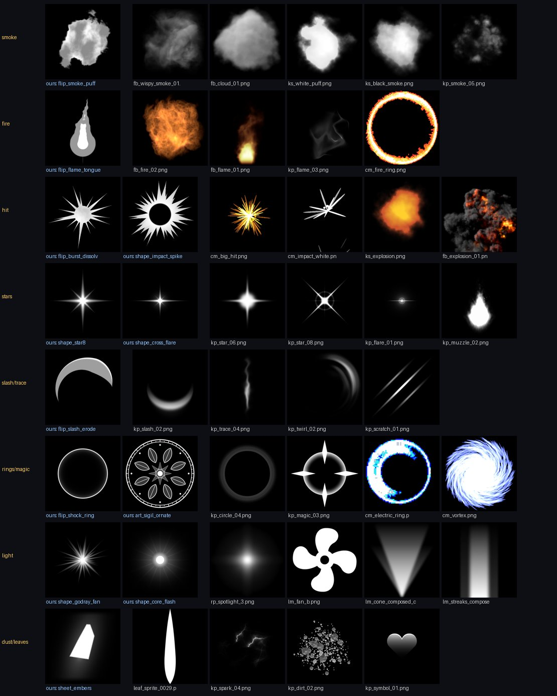

# The CC0 library

Phát, 2026-10-24: CC0 art may go into the library ("we can use it because it's CC0"). Decision 4's ban on
third-party textures still covers everything that is not CC0: Lotus, Frigid Rush, ZonitoVisuals and VFX Forge stay
reference only.

`pack/cc0` holds 327 textures imported from seven CC0 sources. Every one lists its source, author, licence and
original file in `pack/cc0/manifest.json`. Each pack's licence file was read before import and every one says CC0.

| Textures | Author | Source |
|---|---|---|
| 152 | Kenney | [Light Masks](https://kenney.nl/assets/light-masks): cones, fans, circles, windows, streaks, canopy shadows |
| 80 | Kenney | [Particle Pack](https://kenney.nl/assets/particle-pack): circles, dirt, fire, flames, light, magic, muzzle flashes, scorches, scratches, slashes, smoke, sparks, stars, symbols, traces, twirls, windows |
| 50 | Kenney | [Foliage Sprites](https://kenney.nl/assets/foliage-sprites): leaves and grass |
| 5 | Kenney | [Smoke Particles](https://kenney.nl/assets/smoke-particles): black smoke and white puffs (variant sheets), an explosion, a flash, a gas cloud |
| 14 | Thomas Iché, via Brackeys | [Brackeys VFX Bundle](https://brackeysgames.itch.io/brackeys-vfx-bundle): smoke, cloud, fire, flame and explosion flipbooks (64 frames) |
| 14 | CodeManu, via Brackeys | the same bundle: hand-drawn hits, impacts, rings, a vortex, a charge, streaks, fire (16 frames) |
| 12 | Picster | [Godot particle and VFX textures](https://github.com/RPicster/Godot-particle-and-vfx-textures): spotlights and effect textures |

Most of the Brackeys bundle's single particles repack Kenney's and Picster's textures, so those come from the
originals; from the bundle we take only Iché's flipbooks and CodeManu's sheets. Kenney's black-background and rotated
copies, and the inverted light masks, are left out as duplicates.

## How they are imported

```bash
python3 tools/texgen cc0 --dry   # what would be written
python3 tools/texgen cc0         # .cache/cc0/<pack> into pack/cc0 (rules in tools/texgen/cc0.json)
```

Download each pack into `.cache/cc0/<folder>` (the folders are named in `cc0.json`) first. The importer:

- **Normalizes the colour.**
  - `white`: white RGB with the shape in alpha, tinted in Roblox like library v4. Used for 244 textures.
  - `luma`: grey shading kept, for smoke and leaves. Used for 59.
  - `source`: the pack's own colour, for fire and the hand-drawn hits. Used for 24.

  Textures drawn on black get their alpha from their brightest channel.
- **Squares and caps the size:**
  - single sprites at 512, light masks and leaves at 256;
  - sheets and flipbooks at 1024, the largest Roblox loads.
- **Makes Roblox flipbooks.** Roblox plays only 4, 16 or 64 frames. Each animation is resampled in time to one of
  those counts, holding or dropping frames and never blending them, and packed into a 2×2, 4×4 or 8×8 grid:
  - Iché's 16×4 and 15×4 flames become 8×8;
  - CodeManu's 6×5 sheets become 4×4;
  - Kenney's 9-frame explosions become 16 frames.
- **Gives each texture a role** from the VFX grammar, by its name (`roles` in `cc0.json`). The grammar and the studio
  then treat them like our own layers.

The headless renderer (`tools/evfx/render.py`) and the timeline export (`tests/timeline.luau`) read `pack/cc0`, so
`evfx` can draw any preset that uses them. As with library v4, nothing is uploaded until the effects look right.

## Ours beside theirs



| Category | Ours | CC0 adds |
|---|---|---|
| smoke | `flip_smoke_puff`, one procedural puff | real volumetric smoke and cloud flipbooks (Iché), puff and dark smoke variant sheets (Kenney) |
| fire | `flip_flame_tongue`, a flat cartoon flame | fire and flame flipbooks (Iché), flame sprites, a hand-drawn fire ring |
| hits | burst dissolve, impact spikes | hand-drawn big hits and white impacts (CodeManu), cartoon and realistic explosions |
| stars | star8, cross flare, star set | more star, flare and muzzle flash shapes |
| slashes | slash erode, crescent shells | slash, trace, twirl and scratch sprites |
| rings and magic | shock ring, sigils, saw and vortex rings | circles, magic shapes, an electric ring, a hand-drawn vortex |
| light | god-ray fan, core flash | spotlights (Picster), light cones and streaks for god rays and pillars (Kenney) |
| dust | embers, grass, petals | leaves, sparks, dirt, symbols (a heart, a skull) |

**Where CC0 wins:** volumetric smoke, fire and explosions, which our recipes can't yet draw. Hand-drawn hits.
**Where ours win:** sigils, crisp stars, the shells and anything made for a shell or a beam strip, plus everything
tunable by knobs. The grammar's numbers say nothing about taste here: pick in the studio once presets use them.
