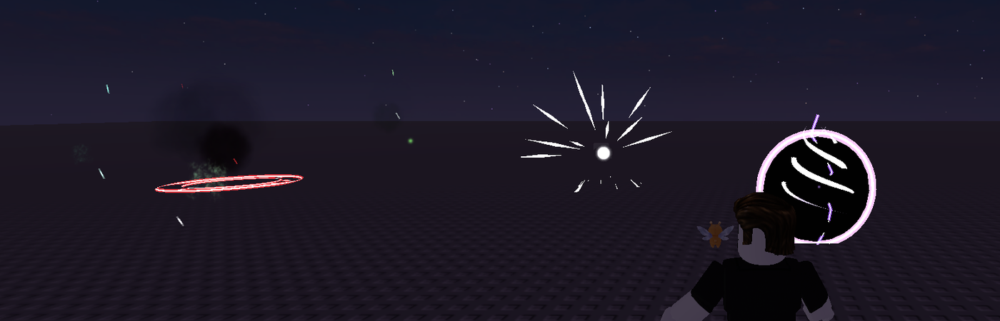
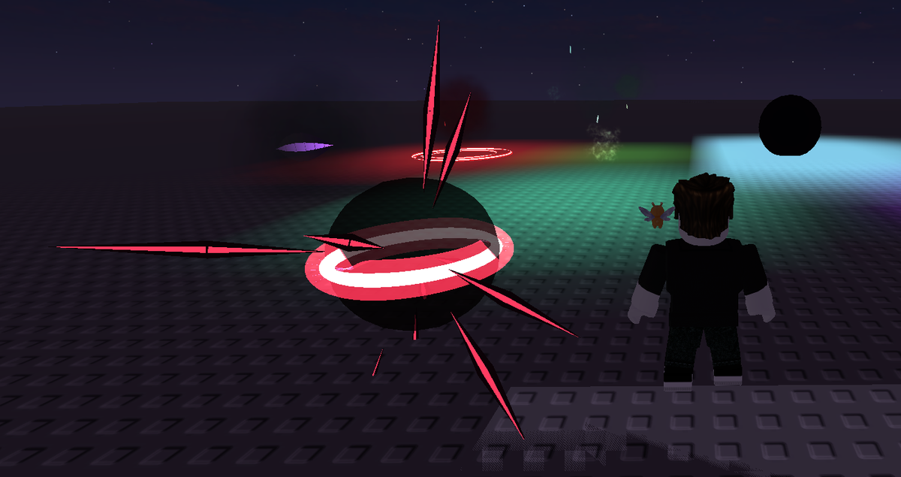

# Dark fantasy VFX: research notes and how EasyVFX does it

*Real Roblox Studio Play session: Void Rift (black disc, violet rim, spiral and bolts pulled in), Soul Release, and Cursed Sigil in the background.*

## What successful games do

| Game | What its effects get right | What EasyVFX takes from it |
|---|---|---|
| **Dark Souls / Demon's Souls remake** | The remake's VFX lead remade 50+ spells and first fixed a **palette and form language per school** (magic vs. miracles), to keep the originals' spirit while making them **clearer to read** ([Adam Rehmann, ArtStation](https://adamrehmann.artstation.com/projects/q9E29e)). | Each dark preset owns one accent color: violet = void, sickly green = necrotic, crimson = blood, cold cyan = souls. |
| **Elden Ring** | Many more effects, of more kinds, than earlier Souls games, built "to extend the dark fantasy world" ([CGWORLD making-of](https://cgworld.jp/article/202206-cgw286-eldenring03.html)). Spells reuse Souls shapes with much more spectacle ([PC Gamer](https://www.pcgamer.com/au/heres-15-minutes-of-elden-ring-the-ultimate-souls-like)). | Familiar shapes (slash, ring, burst) re-dressed dark, not new shapes for their own sake. |
| **Diablo IV** | Art direction built around a shared vision of "gothic" ([GDC 2024, *The Pillars of Hell*](https://www.gdcvault.com/play/1034608/The-Pillars-of-Hell-Achieving)). The world is "inviting in its darkness": light scatters through modelled air, and even stained glass throws light into it ([Blizzard](https://news.blizzard.com/de-de/article/23964183/iv)). | Dark effects carry their own small light (PointLight) so they glow on the ground around them. Pair them with Bloom and darker Lighting. |
| **Hollow Knight** | Readability comes from **value contrast**: the bright white Knight against dark, faded surroundings ([Mechanics of Magic](https://mechanicsofmagic.com/2023/04/18/visual-design-of-games-hollow-knight)). Players complain when everything is the same muted tone ([Steam](https://steamcommunity.com/app/367520/discussions/0/1736588252389157868)). | Every dark body gets a bright, thin edge or core. Nothing is dark-on-dark only. |
| **Blasphemous** | Desaturated, grounded palette; tragic, solemn mood ([Steam](https://steamcommunity.com/app/774361/discussions/0/4040353770027264297), [Xataka](https://www.xataka.com/videojuegos/blasphemous-ii-uno-juegos-ano-su-barroquismo-visual-solo-igualado-unas-mecanicas-afiladisimas)). | Ash & Embers: grey ash falling, sparse embers. The Impact `Mono` style drains color on big hits. |

## The rules EasyVFX follows

1. **Dark body + bright edge.** Additive light can't make black: in additive blending black adds nothing and disappears, so dark smoke and bodies need alpha blending ([Unity](https://discussions.unity.com/t/particle-effects-against-light-backgrounds/86497), [jMonkeyEngine](https://hub.jmonkeyengine.org/t/black-smoke/9957)). The RealtimeVFX community layers an alpha-blended body under an additive highlight ([RealtimeVFX](https://realtimevfx.com/t/additive-alpha-blend-in-unity-shaderforge/2151)). In EasyVFX:
   - **Body:** `Glow = 0` on a shape gives an unlit, opaque ribbon, and particles get `LightEmission = 0, LightInfluence = 1`.
   - **Edge:** `CoreGlow = 1` with a `core` color keeps the thin core additive.
   - **Custom blocks:** this is what the *Dark style* switch does.
2. **One accent per effect**, a near-black body tinted by the second color (the `"x"` / void color token), and white only for the hottest instant.
3. **Heavy timing:** a slow build-up or implosion (Soul Release shrinks first), then a fast release, then smoke and ash that linger. Combine with `Impact` (Invert/Mono) and `Shake` for weight.
4. **Light the scene, not just the effect:** set darker `Lighting` (low `ClockTime` or ambient), add a `BloomEffect`, and prefer `Lighting.Technology = Future`, since voxel lighting draws PointLights as blocky squares on flat ground.

## Dark Fantasy presets

| Preset | Built from |
|---|---|
| Shadow Slash | Unlit black slash with a violet core, a thin violet slash on top, ring needles, dark smoke, small shake |
| Soul Flame | Ghost-green fire, black smoke above it, rising embers, green light |
| Blood Burst | Crimson unlit orb, dark needles with red cores, falling blood drops (gravity), dark ring, flash, shake |
| Void Rift | Black disc with a spinning violet rim, inward spiral strands, inward particles, bolts |
| Cursed Sigil | Two counter-rotating red rings, rune ticks, black smoke rising, embers |
| Necrotic Aura | Green-black miasma, green motes, embers around a character |
| Soul Release | Black implosion → invert frame → bright soul burst, souls rising, shake, flash |
| Ash & Embers | Area weather: grey ash drifting down, sparse embers |

## Where to get more VFX material (legally)

| Source | What it gives | License |
|---|---|---|
| Roblox built-in textures (`rbxasset://textures/particles/...`) | Glow, smoke, fire, sparkles; EasyVFX's basic tier uses them | Built into every Roblox client |
| The EasyVFX HD pack (`blender/make_vfx_pack.py`) | Slashes, flipbooks, sparks, rings you can re-render in your own colors and style | This repository (MIT) |
| [Kenney Particle Pack](https://opengameart.org/content/particle-pack-80-sprites) / [Kenney smoke](https://opengameart.org/content/smoke-particle-assets) | 80 + 77 particle sprites (smoke, magic, sparks) | CC0, no attribution required |
| Roblox Creator Store and DevForum community resources (for example [Roblox Ability Pack](https://devforum.roblox.com/t/roblox-ability-pack/4290278)) | Ready-made effects to study or use | Check each item's terms |
| [RealtimeVFX](https://realtimevfx.com) | Technique breakdowns from working VFX artists | Learning only |

Never rip textures or meshes out of commercial games: their assets are copyrighted. Study how an effect is *built* (layers, timing, color), then rebuild it with your own or CC0 material, which is how every preset here was made.

## Make your own

The plugin's **Create** tab builds effects from the same blocks used by the presets: slash, ring, lines, spiral, orb, lightning, projectile, crater, rocks, sparks, smoke, embers, aura, light, camera shake and impact frame. Each block has a color, a *Dark style* switch (black body, bright edge), delay, size and amount.

- Saved effects appear in the library under **My Effects** and work in every place.
- Every effect made from one stores its own definition (`VFX_CustomDef`), so it stays editable when the place is opened on another computer.
- **Share** gives a code (`EVFX1:…`) that a friend pastes into **Import**. Imported codes are checked: only known blocks are accepted and every number is clamped.

*"Doom Burst", made from 5 blocks in the Create tab: a dark orb, dark needles with red cores, a ring, dark smoke and a camera shake.*
