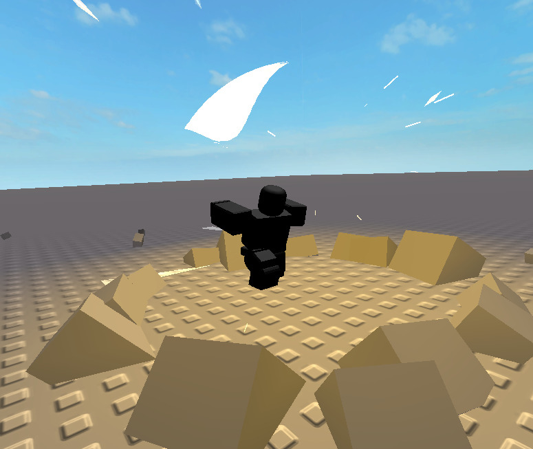

# EasyVFX × Eclipse Animator: the "vibe → edit → asset" flow


*Roblox Studio, Play mode: an animation made by the AI flow, with Crescent Slash fired by an Eclipse emit at 0.30 s and Ground Slam fired by an `EasyVFX` marker at 0.65 s.*

## The flow

1. **Vibe a prototype.** The AI makes the animation on a rig and adds effect cues at the right frames, in **Eclipse Animator's own file format**.
2. **Edit**, either by asking the AI again or by opening the animation in Eclipse Animator and moving, retiming or deleting cues on its event track.
3. **Finalize into an asset:** export or publish from Eclipse. Its export writes the same markers EasyVFX plays in the game.

Every step uses the same data, so there is no conversion between tools.

## What "Eclipse's file format" means here

Eclipse Animator keeps an animation as a `KeyframeSequence` in the rig's `AnimSaves`. Its event track lives inside that sequence:

```
AnimSaves/<animation> (KeyframeSequence)       attribute EclipseEventDocumentId
└── EclipseEvents (Folder)                     Version = 8, FPS = 60, Enabled, Revision…
    └── <guid> (Folder, one per event)         Frame, Duration, Speed, EventName, Parameter, Enabled
        ├── Markers   (StringValue, JSON)      [{ "Name": "EasyVFX", "Parameter": "{…}" }]
        ├── Emits     (StringValue, JSON)      [{ "Mode": "All", "Path": [{Name, Class, Index}…] }]
        ├── CodeBegin / CodeEnd (StringValue)
        └── Sounds (Folder)
```

When exported, every event becomes `KeyframeMarker`s on the keyframe at that frame:
- `EclipseVFX`, with `{"Version":1,"Emits":[…]}`, fires the emits.
- Every custom marker is kept by name, for example `EasyVFX`.

`EasyVFX.EclipseBridge.writeEvents` writes exactly this: the `EclipseEvents` document plus the exported markers, so the animation already works in a game before anyone opens Eclipse. It was checked against Eclipse's own code (build `v10956`, schema 103):
- `Events.load` reads the document back with the right frames, emits and markers.
- `Events.export` produces the same markers EasyVFX writes.

## Two kinds of cues

| Cue | Stored as | Good for |
|---|---|---|
| Effect **inside the rig** (`EclipseBridge.attach` welds it to the root, a hand or a weapon) | Eclipse **Emit**: Eclipse previews its particles in the editor and shows it on the event track | Effects that follow the body: slashes, auras, weapon trails |
| Effect **template** in `ReplicatedStorage.EasyVFX_Effects` | **`EasyVFX` marker**, e.g. `{"effect":"VFX_GroundSlam","at":"HumanoidRootPart","offset":[0,-3,-2.5]}`, or the short form `VFX_GroundSlam@RightHand` | Effects played *at* a place: ground slams, impacts, explosions; one template serves every character |

## In the game

```lua
local EasyVFX = require(game.ReplicatedStorage.EasyVFX)
local track = humanoid.Animator:LoadAnimation(animation)
EasyVFX.BindAnimation(track, character) -- plays EasyVFX and EclipseVFX markers
track:Play()
```

`BindAnimation` plays the **whole** EasyVFX effect, including shape layers, camera shake and impact frames, which Eclipse's own emitter would skip. Don't also bind Eclipse's `EclipseVFX.Bind` for the same EasyVFX effects, or their particles fire twice.

## For AI agents (the "vibe" step)

While Studio is in edit mode, the EasyVFX plugin exposes its authoring modules at `ServerStorage.EasyVFX_Authoring`: `Builder`, `Presets`, `Custom`, `EclipseBridge` and `Runtime`. They are never saved with the place.

1. Make or import the animation into `Rig.AnimSaves`, with Eclipse Animator's MCP tools (`save_animation`, `import_animation_pack`, `video_to_animation`) or as a `KeyframeSequence`.
2. Build the effects and write the cues:

```lua
local A = game.ServerStorage.EasyVFX_Authoring
local Builder, Bridge = require(A.Builder), require(A.EclipseBridge)
local rig = workspace.Hero
local seq = rig.AnimSaves["Slash Combo"]

-- an effect that follows the body
local holder = Instance.new("Part"); holder.Anchored = true; holder.Parent = workspace
local p = Builder.defaultParams("slash"); p.trigger = "Script"
local slash = Builder.create(p, { cframe = CFrame.new(), size = Vector3.new(4, 4, 4), parent = holder })
Bridge.attach(rig, slash, "HumanoidRootPart", CFrame.new(0, 1, -3) * CFrame.Angles(math.rad(90), 0, math.rad(25)))
holder:Destroy()

-- a reusable template, played at a spot
local fx = Instance.new("Folder"); fx.Name = "EasyVFX_Effects"; fx.Parent = game.ReplicatedStorage
local h = Instance.new("Part"); h.Anchored = true; h.Transparency = 1; h.Parent = fx
local p2 = Builder.defaultParams("ground_slam"); p2.trigger = "Script"
local slam = Builder.create(p2, { cframe = CFrame.new(0, -500, 0), size = Vector3.new(4, 4, 4), parent = h })

Bridge.writeEvents(rig, seq, {
	{ time = 0.30, effect = slash, name = "Slash" },
	{ time = 0.65, effect = slam, at = "HumanoidRootPart", offset = Vector3.new(0, -3, -2.5), name = "Ground Slam" },
})
```

3. Check it: `Bridge.readEvents(seq)` lists the cues, Eclipse's `preview_animation` plays the motion, and a Play session with `BindAnimation` plays everything.

Re-running `writeEvents` replaces the previous cues; it never duplicates them. Cues on the same frame share one Eclipse event, as they do in Eclipse.
