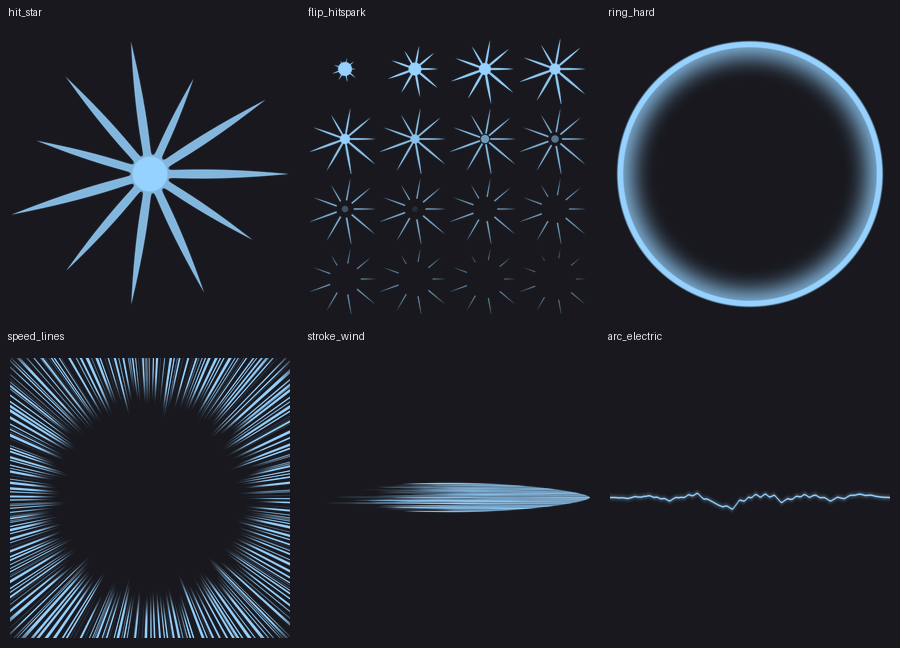
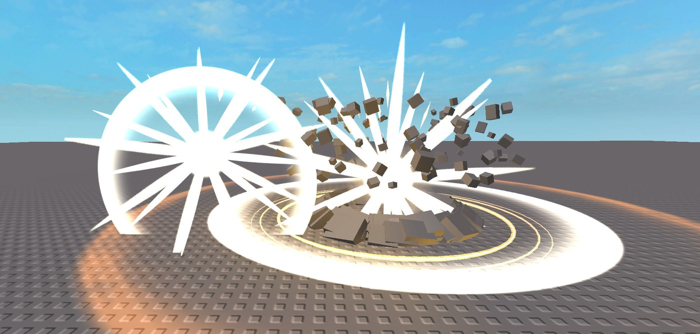

# Making hits feel heavy

*The v3 textures, rendered by `blender/make_vfx_pack.py`: hit star, hit spark flipbook, hard ring, speed lines, wind stroke and electric arc.*

*Real Roblox Studio Play session, hit sparks slowed 8x to catch them. At normal speed the white star holds for 2–3 frames, then the spikes shoot out and hollow.*

## What gives an effect weight

| Rule | Why | EasyVFX tool |
|---|---|---|
| **Hit-stop**: freeze 50–100 ms on a heavy hit | The pause tells the brain "contact". Shorter goes unnoticed; longer reads as lag ([uhiyama-lab](https://uhiyama-lab.com/en/notes/unity/unity-game-feel-hit-feedback/), [eastondev](https://eastondev.com/blog/en/posts/dev/20260521-game-feedback-feel/)) | `HitStop` shape (`Duration`), `EasyVFX.HitStop(s)`. Effects hold their frame, and animation tracks registered with `EasyVFX.TrackHitStop(track)` slow down |
| **Hold a hard white flash for 2–3 frames** | A white flash, then dark, then the color fading gives the hit depth ([RealtimeVFX](https://realtimevfx.com/t/stylised-explosive-and-fiery-hit-spark-looking-for-feedback/11286)) | `hit_star` (0.09 s hold) → `flip_hitspark`, plus `Impact` Invert → Mono |
| **Hard shapes** | Spikes and crisp rims read instantly; soft blobs read as weak | v3 textures with ~2 px anti-aliased edges |
| **Secondary layers end first** | A shockwave brighter or longer than the strike steals the focus ([RealtimeVFX](https://realtimevfx.com/t/lightning-strike-stylized-what-do-you-guys-think-update/1972)) | `ring_hard` lives 0.2–0.3 s, shorter than the main effect |
| **Camera kick, not wobble** | Full strength on the first frame, decaying fast, says "impact"; long, even noise says "earthquake" | `Shake` with `Kick = true`; `Punch` (FOV zoom of a few degrees, easing back) |
| **Anticipation** | Much of a hit's weight comes from the moment before contact ([playbooks](https://playbooks.com/skills/omer-metin/skills-for-antigravity/vfx-realtime)) | Charge Up, converging `Lines`, `Delay` on the hit layers |
| **Fast in, long glide** | Circular easing gives the fastest start and a long slow-down; used for slashes and shockwaves in Roblox slash tutorials | `Ease = "Circ"` on any shape |
| **Manga speed lines** | Focus lines push the eye to the hit | `Impact` with the `speed_lines` overlay (HD) |

All of these are on the heavy presets: Hit Impact, Ground Slam, Explosion, Lightning Slash, Flash Step, Fireball, Impact Frame, Blood Burst, Soul Release, Shockwave and Energy Blast. In the **Create** tab they are blocks: **Hit spark**, **Hit-stop**, **Camera punch**, **Camera shake** (now a kick) and **Impact frame** (with speed lines).

## The v3 textures

| Texture | Used for |
|---|---|
| `hit_star` | 2–3 frame white hit flash |
| `flip_hitspark` (4×4) | Spikes shooting out, hollowing and thinning |
| `ring_hard` | Crisp anime shockwave ring, gone fast |
| `speed_lines` | Full-screen manga focus lines in `Impact` |
| `stroke_wind` | Dry-brush stroke: `Streak` draws its dash as one textured beam (`Whirl` stays untextured: a long curved beam twists the texture) |
| `arc_electric` | Jagged arc: `Crackle` draws each arc as one textured beam |

The Blender script makes them (`--only hit_star,flip_hitspark,ring_hard,speed_lines,stroke_wind,arc_electric`). The PNGs are in `pack/textures/`. They are uploaded and built into `src/Plugin/Shared/DefaultAssets.luau`, so they are on with HD.
