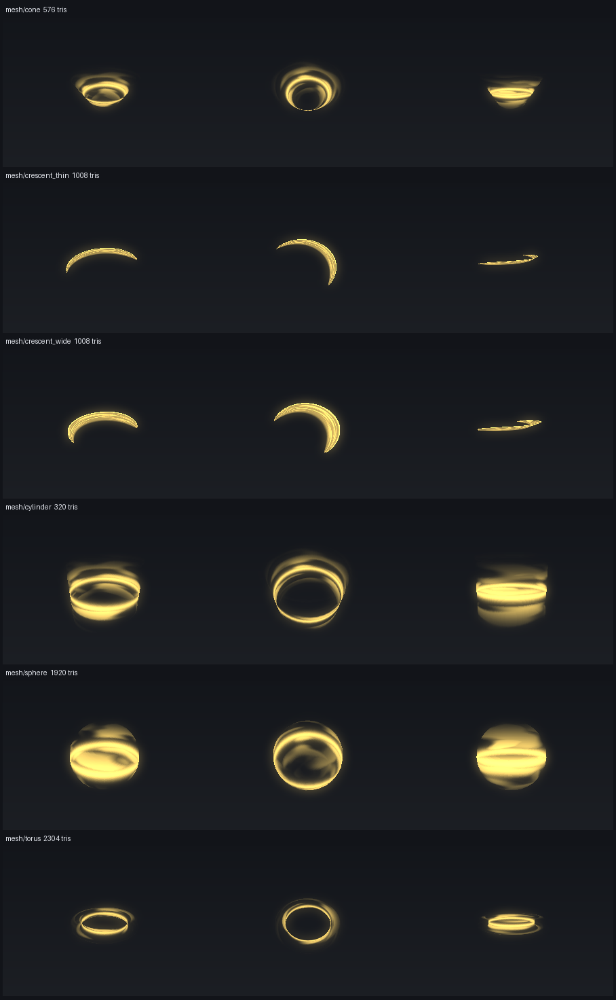
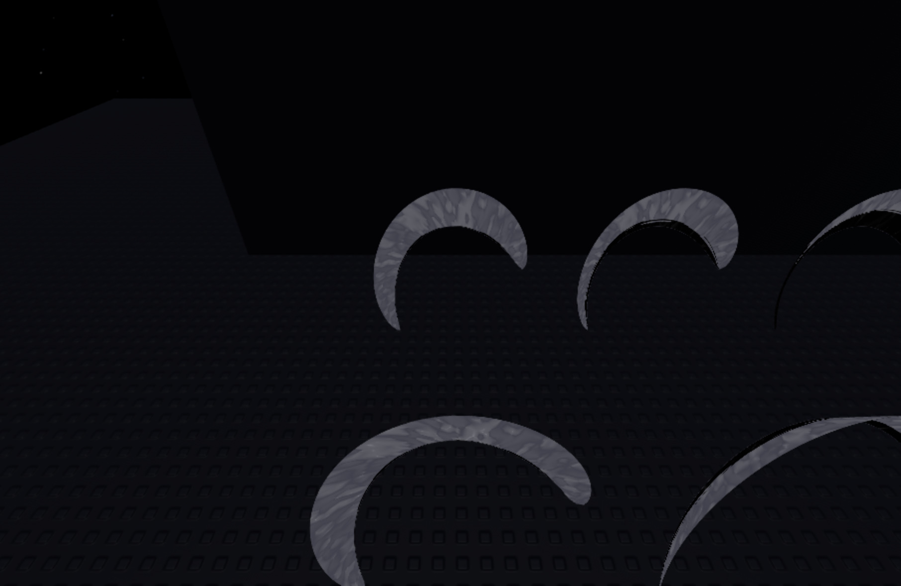
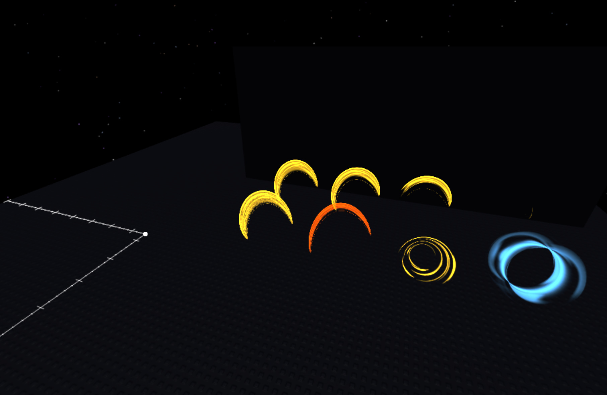
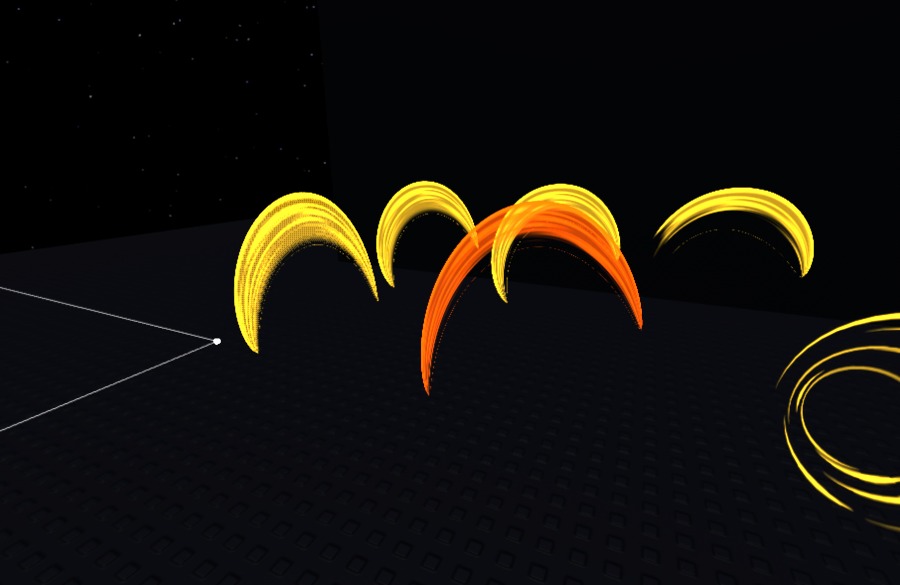
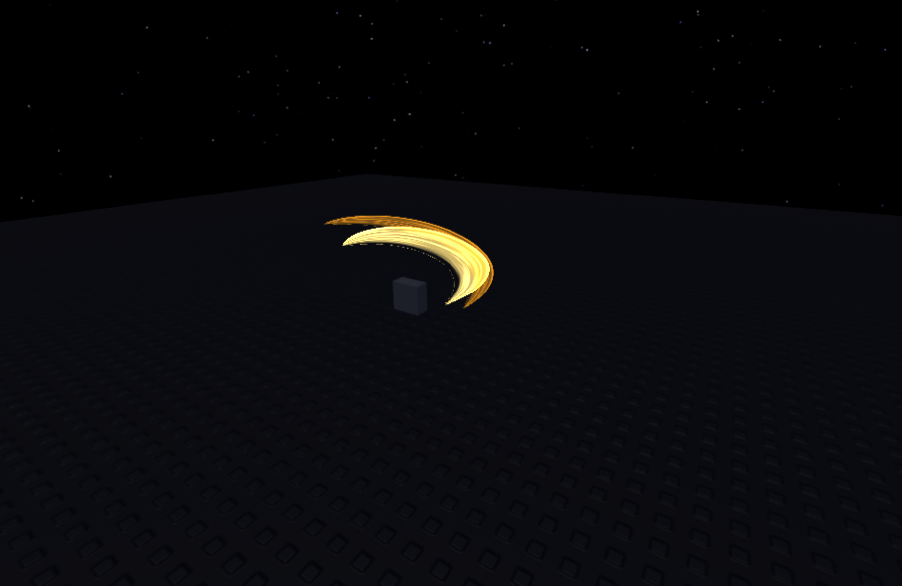
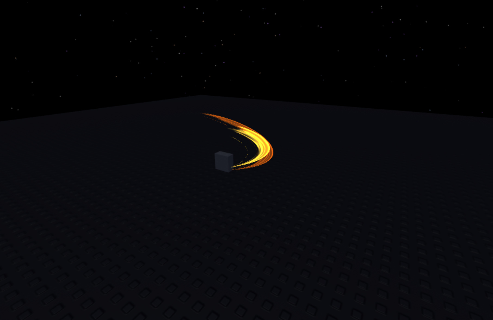
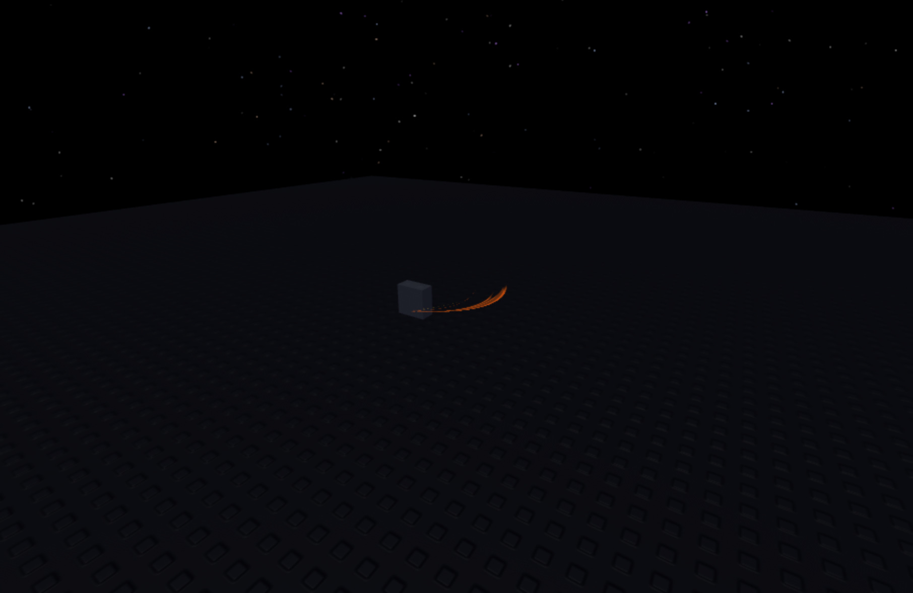

# meshgen: the mesh set as recipes

`tools/meshgen` writes the shells of plan [§3](plan-real-vfx.md#3-asset-pipeline) step 2 as OBJ files, in Python with
numpy only, the way [texgen](texgen.md) writes textures. Each shell is a recipe with knobs in
`tools/meshgen/shells.py`, listed in `tools/meshgen/bank.json`, and written to `pack/meshes/<family>_<name>.obj` with
a `manifest.json` for the ledger script. Nothing is uploaded yet.

```bash
python3 tools/meshgen list
python3 tools/meshgen build            # pack/meshes
python3 tools/meshgen check            # the rules, and the files still match their recipes
python3 tools/meshgen sheet -o docs/meshes/sheet.png
```



| Mesh | Use |
|---|---|
| `mesh/crescent_wide`, `mesh/crescent_thin` | slash shells: a band swept around an arc, pointed at both ends, tilted into a shallow cone for depth |
| `mesh/cone` | a burst thrown up from the ground |
| `mesh/sphere` | a dome flash or a shield |
| `mesh/torus` | a ring that keeps its thickness at any angle |
| `mesh/cylinder` | a light pillar or a beam's body |

## Rules

- At most 5000 triangles (Roblox allows 20000).
- No degenerate triangles.
- UVs in 0..1: u along the shell (a slash's tail to its tip, or around a ring), v across it.
- The shell fits the box -0.5..0.5 with its largest side 1, since Roblox scales a mesh's bounds to its MeshPart's
  Size.
- Two-sided: every triangle has a reversed twin, because `MeshPart.DoubleSided` can't be set from a script.

## In presets

A `shell` layer names a mesh and its texture frames:

```lua
{ type = "shell", hd = true, mesh = "mesh_crescent_wide", frames = { "seq_slash_ribbon_00", ... },
  attrs = { Size0 = Vector3.new(8, 1.2, 8), Size1 = ..., Duration = 0.3, SpinDeg = ..., Tilt = ..., Offset = ... },
  color0 = "w", color1 = "p" }
```

- **Building:** a script can't set `MeshId`, so the builder makes a hidden lead MeshPart with
  `AssetService:CreateMeshPartAsync` (plugins may call it). A MeshPart's `TextureID` alpha doesn't cut it out (see
  "In Studio" below), so the builder also bakes one frame MeshPart per texture frame under the lead. Each frame gets
  its own `SurfaceAppearance`: `AlphaMode` Transparency, the frame as `ColorMapContent` and `EmissiveMaskContent`.
  Only a plugin may set those.
- **Playing:** the runtime clones the lead and shows one frame at a time. The visible frame grows from `Size0` to
  `Size1`, turns by `SpinDeg` and fades (never below `Transparency` 0.02, where the alpha dithers). The runtime also
  sets the `SurfaceAppearance`'s `Color`, `EmissiveTint` and `EmissiveStrength` (`Emissive`, default 3), which scripts
  may write.
- **Cost:** every frame is a MeshPart, so a shell carries few frames; `slash_v4` uses every other ribbon frame (8).
- **Frames:** texgen's `sequence` kind writes frames as separate images (`seq/slash_ribbon` gives 16).
- **Before upload:** without uploaded IDs the layer is skipped.
- **evfx:** draws `pack://` meshes from `pack/meshes`, with perspective-correct UVs and two-sided coverage counted
  once.

## In Studio (2026-10-23, edit mode, no upload)

`python3 tools/meshgen studio` writes a preview script in chunks: a setup chunk, then one per shot. Each shot builds
its shell with `EditableMesh` and its frame with `EditableImage`, so nothing has to be uploaded. What it showed:

- **`TextureID` alpha doesn't cut a MeshPart out.** The shells drew the full band in every frame, opaque and grey;
  transparent texels let the part's `Color` show through instead.

  
- **`SurfaceAppearance` with `AlphaMode = Transparency` does cut it out.** With the frame as `ColorMapContent` and
  `EmissiveMaskContent`, `EmissiveStrength` 3 and `Color` and `EmissiveTint` set to the element colour, the shells
  glow and the ribbon erodes frame by frame. Set `Transparency` to 0.02, not 0: at 0 the alpha is dithered.

  
  
- **Only a plugin can write the colour map.** `SurfaceAppearance.ColorMap` and `ColorMapContent` need
  `PluginSecurity`. `AlphaMode`, `Color`, `EmissiveStrength` and `EmissiveTint` are writable at runtime. So the
  builder (a plugin) has to bake one part per frame with its own `SurfaceAppearance`, and the runtime can only switch
  which one is visible and drive its emissive. The `shell` layer works that way now.

### The runtime path in Studio (2026-10-23, edit mode, no upload)

`python3 tools/meshgen studio --play` writes the data for `slash_v4`'s two crescent shells and every other ribbon
frame. In an edit Studio:

1. The data is turned into `EditableMesh` and `EditableImage` content and handed to `Builder.previewContent`.
2. The real `Builder.create` baked each shell: a lead plus 8 frame MeshParts, each with its own `SurfaceAppearance`.
3. The runtime's `PlayLocal` played it at 1/20 speed.

One frame showed at a time, stepping from Frame02 to Frame05 to Frame07. The arc turned and its tint shifted, the tail
eroded, and the shell faded. It ran in edit mode because an `EditableImage` doesn't survive the copy into a Play
session.




