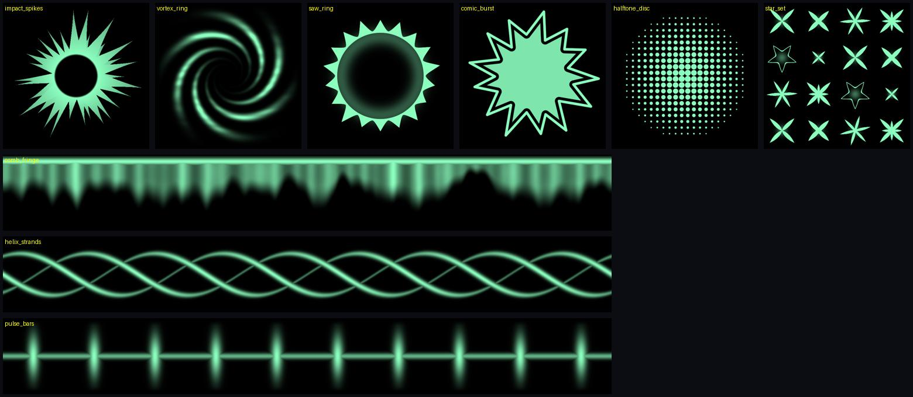

# Reference: a beam built with a paid plugin

[Twist VFX, *How to Make a Simple Beam Effect*](https://www.youtube.com/watch?v=1swzmhdnylI) (42 min, 1080p60). Over
the video he builds one green beam from start to finish in Roblox Studio, using the paid plugin ZonitoVisuals 3.2
(early access 2). Its texture palette sits in the left panel the whole time. Studied on 2026-10-24 for its shapes
and its layering. The clip and the frames stay in `.cache/refs/clip3`, untracked. Their textures are theirs: we draw
our own (call 4).

## The beam's layers

Back to front, as built:

| Layer | Role | What it is |
|---|---|---|
| Darkness crescents | dark | dark, normal-blend crescent arcs swirling around the caster (32:50) |
| Charge orb | glow | a soft green glow at the hand before it fires (41:20) |
| Core beam | base | a tapered beam, white at the centre with green edges, wider at the muzzle (25:40) |
| Fibre ribbons | shards | several thin streaky beams twisted along the core (3:30, 13:50) |
| Pulse beam | base | a beam whose texture repeats bright bars, scrolled fast so energy pulses down it (26:10) |
| Muzzle ring | ground (flat) | a flat shockwave ring facing along the beam, at the muzzle (17:50) |
| Muzzle and end stars | glint | a 4-point star flare at each end (23:10, 42:00) |
| End impact | base | a ring and a sphere shell where the beam lands, with shards (32:20) |
| Orbit rings | dust | small rings orbiting the impact point (33:40) |

The plugin's own tools match the knobs in our studio (`evfx serve`):
- **Resize** and **Retime:** scale size and time by 0.5, 1, 2 or 3.
- **Copier:** copy colour, size or transparency from one layer to another.
- **Shifter:** shift a curve.
- **Curve editor:** base shapes (line, linear, ease) for size and transparency over life.
- **Emit panel:** count, delay and duration per emitter.

So the craft is in the curves and the timing, which is what the grammar measures.

## The palette's shape vocabulary

| Group | Shapes |
|---|---|
| Statics | soft and hard glow discs, rimmed discs, a heart, a plus, cloud puffs, pebble blobs |
| Stars | long thin 4-points, fat 4-points, 6- and 8-points, an outlined star, tiny twinkles |
| Impacts | a spike burst around a hollow centre, a vortex ring, a ring of outward shards, a chromatic flower, a comic starburst, thick and broken rings |
| Scatter sheets | chevrons, fragments, sparkle sets, dot rows, rings |
| Beam strips | streak combs with jagged ends (icicles), twisting wavy strands, S-swooshes, lightning cracks and roots, stripe bands |
| Halftone | halftone-dot discs and spheres |
| Meshes | a crystal shard, half and full tori, chevron strips |

## What we built from it

New texgen recipes, drawn from scratch (`tools/texgen/recipes.py`, "the beam showcase set"):

| Id | Shape |
|---|---|
| `shape/impact_spikes` | a radial spike burst around a hollow centre, spikes of uneven length |
| `shape/vortex_ring` | a spiral vortex ring for a charge or suction |
| `shape/saw_ring` | a ring of outward shards (a sharp circle impact) |
| `shape/comic_burst` | a comic starburst splat with an outline |
| `shape/halftone_disc` | a halftone-dot glow |
| `sheet/star_set` | 16 star and sparkle variants |
| `strip/comb_fringe` | a hanging comb of streaks that frays a beam's edge |
| `strip/helix_strands` | strands twisting around a beam |
| `strip/pulse_bars` | bars pulsing down a beam |

We already had the others: `shape/core_flash`, `shape/bokeh`, `shape/star8`, `art/fringe_ring`, `strip/energy_streak`,
`strip/lightning_fringe`, `mesh/torus`, the crescent shells and `art/brush_strokes`. Next: a beam preset built on this
stack and checked with `evfx grammar` and `evfx beats`.
