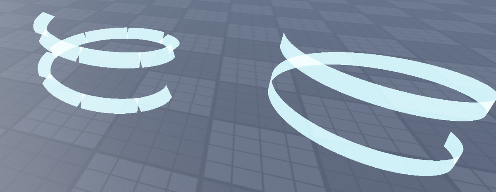

# Making Roblox VFX sharp (not blurry, not pixelated)

These rules come from testing EasyVFX in Roblox Studio and measuring its texture pack. Each one says what goes wrong, why, and what EasyVFX does about it.

## 1. Get the hard edges from geometry, not from textures

A texture is a fixed grid of pixels. Blow a 256 px particle up to half the screen and every texel becomes a visible block, or a blur. Edges made from **geometry** are different: Beam ribbons, Neon/ForceField parts and meshes are rasterized at screen resolution, so they stay crisp at any size and distance.

- EasyVFX builds rings, slashes, needles, lightning, spirals and projectile trails from curved **Beams**, and flashes and cores from **Neon** parts.
- Textures, when used, carry only *soft* detail (glow falloff, strands, noise). The silhouette comes from the geometry.

## 2. Chained beams must share camera-facing attachments (no `FaceCamera`)



*Real Studio render. Left: 12 beams with `FaceCamera = true`; every joint shows a notch. Right: the same helix with `FaceCamera = false` and attachments oriented consistently: one seamless ribbon.*

With `FaceCamera = true`, each Beam turns towards the camera **on its own**, so two beams meeting at an attachment have different width directions at the joint. That leaves a notch or step at every joint, the "jagged" look on curved slashes and rings.

What EasyVFX does instead (`ribbonFrame` in the runtime):
- `FaceCamera = false` on every beam.
- Each frame, every attachment gets X = the path tangent (the axis `CurveSize` bends along) and Y = `tangent × (camera − point)`. A beam's width follows its attachments' Y axes.
- Neighbouring beams share the attachment, so they meet exactly, and the ribbon still faces the camera.
- For zig-zag lightning the tangent at a corner is the average of the two segments (a **miter joint**), so the bolt bends cleanly instead of overlapping.

## 3. One gradient across a chain, not one per segment

`ColorSequence.new(a, b)` on every segment restarts the gradient at each joint, which shows as color bands. Give each segment its slice of the overall gradient: `a:Lerp(b, f0)` to `a:Lerp(b, f1)`. The same goes for `Transparency` and `Width`: compute them from the position along the whole chain.

## 4. Clean texture edges (edge padding)

Renderers (Blender Cycles included) write **black RGB into fully transparent pixels**. Roblox filters textures bilinearly and builds mipmaps from straight alpha, so that black bleeds into every soft edge. The result is a grey or dark rim, and a dirty, crunchy look once the effect is a bit away from the camera.

The EasyVFX pack measured 0.01–0.22 RGB in its transparent areas. `tools/fix_texture_edges.py` pushes the visible color outwards (push-pull fill) without touching alpha, and `blender/make_vfx_pack.py` now writes white RGB everywhere, because every pack texture is white with the shape in alpha. The pack was re-rendered that way: the PNGs went from 3.5 MB to 1.4 MB and the FBX from 3.7 MB to 2.0 MB.

```bash
python tools/fix_texture_edges.py pack/textures/*.png
```

## 5. Spend texture resolution where it shows

- Roblox images are at most **1024 × 1024**, and lower graphics settings load smaller mips.
- A 4×4 flipbook on a 1024 sheet leaves **256 px per frame**. That is fine for small or fast bursts (impacts, sparks), but blurry on a big slow effect. Use `Grid2x2` (512 px frames) or a single texture for anything that fills the screen.
- Strip textures for beams and trails only need detail across their width. A 1024 × 64 strip stretched along a beam stays crisp, because filtering along a smooth gradient is invisible.
- Don't stretch a small soft particle to be huge. Make a bigger texture, or use an Orb part.

## 6. Glow without mush

- `LightEmission = 1`, `LightInfluence = 0` for additive, self-lit glow.
- Use a white core plus a colored rim (two beams) instead of one flat color. The bright core reads as "hot" and keeps the edge defined.
- `Brightness > 1` on beams and particles, together with a `Bloom` effect in Lighting, gives an anime-style glow without blurry textures. The plugin has a button that adds Bloom.
- Use `ZOffset` to keep cores in front of rims so they don't flicker when they sort.

## 7. Motion sells sharpness

- Fast in, slow out (`Out` easing). A white flash first, then the main color, then gone within about 0.35 s. Long, slow fades make effects look soft.
- Sparks: square texture, `VelocityParallel` orientation and negative `Squash`, so they are needles, not dots.
- A 2–4 frame **impact frame** (`Impact` shape) and a short **camera shake** (`Shake` shape) make a hit read as crisp, even when the particles themselves are simple.

## Checklist

- [ ] Silhouettes come from Beams, Neon or meshes; textures only add soft detail.
- [ ] Chained beams use shared, camera-facing attachments (no `FaceCamera`).
- [ ] Gradients run across the whole chain, not per segment.
- [ ] Textures are edge-padded (`tools/fix_texture_edges.py`).
- [ ] Flipbook frame size matches how large the effect gets on screen.
- [ ] Additive glow with a white core; Bloom in Lighting.
- [ ] Fast timing; impact frame and shake on big hits.
