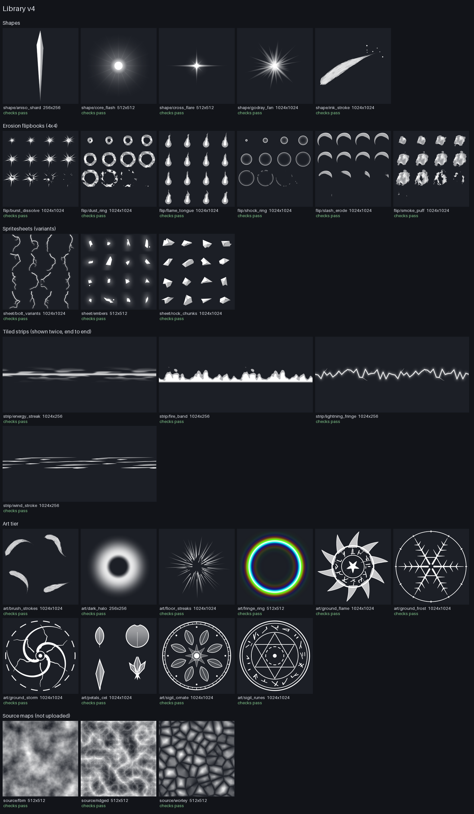

# texgen: VFX textures as recipes

`tools/texgen` draws library v4 (plan [§3](plan-real-vfx.md#3-asset-pipeline)) in Python, with numpy and Pillow only.
Every texture is a recipe rendered by id with a few knobs, the way earshot's sound bank works (plan §8). Change a knob
to get a variant; no one-off PNGs.

```bash
pip install -r tools/evfx/requirements.txt
python3 tools/texgen list                       # every id: kind, size, role, use
python3 tools/texgen build                      # all of it, into pack/generated (+ manifest.json)
python3 tools/texgen sheet -o docs/texgen/sheet.png   # the contact sheet, and strips.png next to it
python3 tools/texgen gif flip/slash_erode       # a flipbook, frame by frame
python3 tools/texgen check --fresh              # the rules, and the files still match their recipes
python3 tools/texgen build shape/godray_fan --seed 9 --set rays=40 -o /tmp/fan.png   # a variant, written elsewhere
```



## How it fits together

| File | Holds |
|---|---|
| `tools/texgen/lib.py` | primitives: tileable Perlin fBm, ridged and Worley noise, domain warp, signed-distance shapes, polar wrap, erosion, atlas, tapered strokes with bristle fibres, a spectrum |
| `tools/texgen/recipes.py` | one function per texture, `fn(knobs, rng, size)`, with its default knobs |
| `tools/texgen/bank.json` | the library: each id's recipe, kind, size, grid, seed, role (plan §4a) and use |
| `tools/texgen/checks.py` | the rules below |
| `pack/generated/` | the built PNGs and `manifest.json` (kind, size, grid, role, sha256, upload) for the ledger script |

Ids are `<family>/<name>`; the file is `<family>_<name>.png`. Uploaded textures stay in `pack/textures`; a v4 name
may not clash with one there. Every texture is white RGB with the shape in alpha. The one exception is
`art/fringe_ring`, whose bank entry says `"rgb": "spectrum"`, since the rainbow is the point.

## Checks

`check` (and `build`, on every texture it draws) enforces:

- both sides a power of two, at most 1024;
- white RGB, unless the entry allows colour;
- a flipbook or sheet divides by its grid, and a flipbook has grid × grid frames;
- each sprite, and each frame of a flipbook or sheet, fades to zero before its border;
- strips tile along their length and fade at their top and bottom; source maps tile both ways;
- a dissolve's last frame is empty.

`selftest` checks the primitives' maths, plants one bad case per rule (each must fail with its reason), renders every
recipe small and checks it, and checks the flame loop's last frame flows into its first. `tools/check.sh` and CI run
`selftest` and `check --fresh`.

## In evfx

`evfx` draws `pack://<name>` from `pack/textures`, then `pack/generated`, and `tests/timeline.luau` maps every name in
`pack/generated/manifest.json`, so a preset layer with `pack = "flip_slash_erode"` renders headless before anything is
uploaded. In Studio, the builder skips a `pack` layer that has no uploaded id, so presets switch to v4 names only
after the ledger upload. `docs/texgen/presets-v4-readback.patch` is the switch used for the step 1 readback (slash,
impact, ground slam); it isn't applied.
