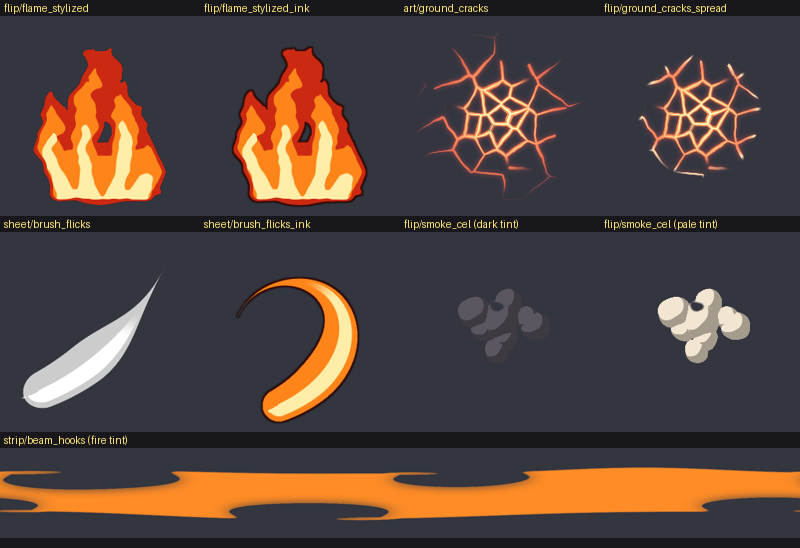

# texgen: VFX textures as recipes

`tools/texgen` draws library v4 (plan [§3](plan-real-vfx.md#3-asset-pipeline)) in Python, with numpy and Pillow only.
Every texture is a recipe rendered by id with a few knobs, the way earshot's sound bank works (plan §8). Change a knob
to get a variant; no one-off PNGs.

```bash
pip install -r tools/evfx/requirements.txt
python3 tools/texgen list                       # every id: kind, size, role, use
python3 tools/texgen build                      # all of it, into pack/generated (+ manifest.json)
python3 tools/texgen sheet -o docs/texgen/sheet.png   # the contact sheet, and strips.png next to it
python3 tools/texgen gif flip/slash_erode       # a flipbook, frame by frame
python3 tools/texgen check --fresh              # the rules, and the files still match their recipes
python3 tools/texgen build shape/godray_fan --seed 9 --set rays=40 -o /tmp/fan.png   # a variant, written elsewhere
```


## How it fits together

| File | Holds |
|---|---|
| `tools/texgen/lib.py` | primitives: tileable Perlin fBm, ridged and Worley noise, domain warp, signed-distance shapes, polar wrap, erosion, atlas, tapered strokes with bristle fibres, a spectrum |
| `tools/texgen/recipes.py` | one function per texture, `fn(knobs, rng, size)`, with its default knobs |
| `tools/texgen/bank.json` | the library: each id's recipe, kind, size, grid, seed, role (plan §4a) and use |
| `tools/texgen/checks.py` | the rules below |
| `pack/generated/` | the built PNGs and `manifest.json` (kind, size, grid, role, sha256, upload) for the ledger script |

Ids are `<family>/<name>`; the file is `<family>_<name>.png`. Uploaded textures stay in `pack/textures`; a v4 name
may not clash with one there. Every texture is white RGB with the shape in alpha, unless its bank entry says otherwise:
- `"rgb": "spectrum"` (`art/fringe_ring`, since the rainbow is the point);
- `"rgb": "luma"` (grey bands to tint);
- `"rgb": "ramp"` (a baked palette, used with a white tint).

## Checks

`check` (and `build`, on every texture it draws) enforces:

- both sides a power of two, at most 1024;
- white RGB, unless the entry allows colour;
- a flipbook or sheet divides by its grid, and a flipbook has grid × grid frames;
- each sprite, and each frame of a flipbook or sheet, fades to zero before its border;
- strips tile along their length and fade at their top and bottom; source maps tile both ways;
- a dissolve's last frame is empty.

`selftest` checks the primitives' maths, plants one bad case per rule (each must fail with its reason), renders every
recipe small and checks it, and checks the flame loop's last frame flows into its first. `tools/check.sh` and CI run
`selftest` and `check --fresh`.

## Stylized generators

The target look is stylized: hard-edged painted shapes in a few flat value bands, with soft realistic touches (the
fire pit and projectile dissections in `docs/refs`, and the Valorant muzzle flashes). Phát picked each default from
variants, 2026-10-24.



| Id | Recipe | What it is |
|---|---|---|
| `flip/flame_stylized` | `flame_stylized` | a looping flame in three bands (rim, body, core), stepped on twos |
| `flip/flame_stylized_smooth` | `flame_stylized` | the same flame with all 64 frames |
| `flip/flame_stylized_ink` | `flame_stylized` | the same flame with a thin dark-red ink line |
| `art/ground_cracks` | `ground_cracks` | glowing Voronoi cracks: small cells in the middle, larger outward; hot thick lines that thin to red |
| `flip/ground_cracks_spread` | `ground_cracks` | the cracks spreading out from the centre with a hot front, then holding |
| `sheet/brush_flicks` | `brush_flicks` | 16 hard-edged strokes (flick, thorn, comma, crescent, lick) in grey bands, to tint |
| `sheet/brush_flicks_ink` | `brush_flicks` | the same strokes in the fire ramp with an ink line |
| `flip/smoke_cel` | `smoke_cel` | a cel-shaded puff of round lobes in two tones; it swells, drifts and breaks up through big holes |
| `strip/beam_hooks` | `beam_hooks` | one beam streak whose edges are bitten by wide curled hooks; it tiles along U |

- **Flame:** a sim (`tools/texgen/sim.py` `flame_loop`, baked into `pack/sim/flame_loop.npz` by
  `.venv-sim/bin/python tools/texgen/sim.py flame_loop -o pack/sim/flame_loop.npz`) moves the tongues; the recipe
  shapes them. Its knobs:
  - `base`: a knot of heat at the bottom;
  - `wide`: stretches the flame sideways;
  - `tips`: pulls the tongues into tapered points;
  - `kink`: bends the tongues into brush flicks;
  - `core_drop`: sinks the core;
  - `ink`: adds an outline.

  Tip sharpness goes with the element: fire keeps 0.16, lightning goes sharper, water softer.
- **Cracks:** additive. The cells are `radial` or `hex`. `drop` breaks edges off toward the rim, and `pool` fills the
  centre cell.
- **Smoke:** every noise field is fixed for the whole flipbook and only thresholds move, so it never flickers. Tint it
  dark for fire smoke, pale for dust.
- **Beams:** Phát's rule is that a beam's taper and its slowing come from the Beam's properties (`Width0`, `Width1`,
  `Transparency`, `TextureSpeed`), not the texture. So `beam_hooks` keeps an even width and tiles. The streak is the
  clear gap, centred, between dark bands that wrap across the strip's top and bottom. The hooks on the two edges are
  staggered, so the streak never closes.

## In evfx

`evfx` draws `pack://<name>` from `pack/textures`, then `pack/generated`, and `tests/timeline.luau` maps every name in
`pack/generated/manifest.json`, so a preset layer with `pack = "flip_slash_erode"` renders headless before anything is
uploaded. In Studio, the builder skips a `pack` layer that has no uploaded id, so presets switch to v4 names only
after the ledger upload. `docs/texgen/presets-v4-readback.patch` is the switch used for the step 1 readback (slash,
impact, ground slam); it isn't applied.
